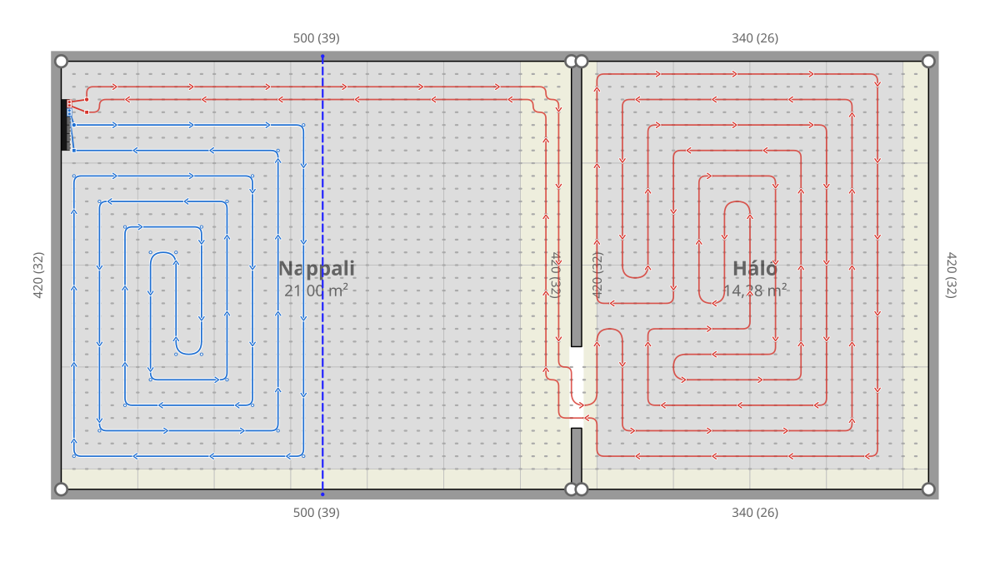

# Padlófűtés nyomvonaltervező

Böngészőben futó tervezőeszköz padlófűtés csőnyomvonalának megtervezéséhez rendszerlemezes (75×100 cm, 12,5 cm-es raszter, Ø14 mm cső) rendszerhez.

**Élő változat (Claude-artifact):** https://claude.ai/artifact/1UkdpoWvcM47Jjo1Fewk3j  
**Helyben:** nyisd meg az `index.html`-t böngészőben (internetkapcsolat a betűtípushoz és a PDF-nyomtatáshoz kell).



## Fő funkciók
- Több helyiség, falak (egy fal két helyiség között), ajtók, osztók (falon / falba süllyesztve), kizárt területek.
- Kézi csőrajzolás rácsra illesztve, zárolás, kijelölés (területkijelöléssel), vonalzó.
- Automatikus kitöltés csigavonallal (bifiláris) vagy kígyóvonallal: zónánként, az aktív körrel, a zárolt és más körök érintetlenül hagyásával; bekötés az osztóig ajtókon át.
- Ellenőrzés: ütközés, falközeli pont, szoros visszafordulás, rácson kívüli pont, ferde szakasz, fal alatti átvezetés, körhossz; hibák elfogadhatók.
- Rendszerlemez-kiosztás helyiségenkénti optimalizálása, bruttó/nettó terület, csőigény.
- Nyomtatás kétoldalas A4-es PDF-be (adatok + rajz), mentés/betöltés JSON-fájlba.

## Fejlesztés
```bash
npm install        # jsdom a tesztekhez
npm run check      # szintaxis-ellenőrzés
npm test           # forgatókönyv-tesztek
node tests/render.mjs examples/user-plan-latest.json out.svg   # rajz kiírása SVG-be
```
A fejlesztési szabályok: [`CLAUDE.md`](CLAUDE.md); követelmények: [`docs/requirements.md`](docs/requirements.md); algoritmusok: [`docs/algorithms.md`](docs/algorithms.md); nyitott feladatok: [`docs/backlog.md`](docs/backlog.md).
